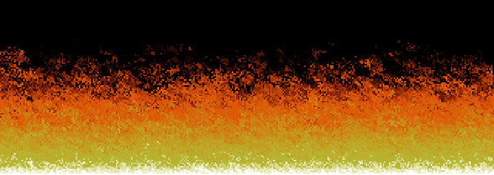

# PSX Fire

*English below.*

Fuente para OBS Studio con el fuego de la pantalla de título del DOOM de PlayStation, simulado en tiempo real con el algoritmo y la paleta de 37 colores originales, tal como los documentó Fabien Sanglard en [“How DOOM fire was done”](https://fabiensanglard.net/doom_fire_psx/).



- La simulación corre en la CPU, un byte por celda; la paleta, la transparencia y el escalado los aplica un shader en la GPU.
- Fondo transparente con fundido configurable, para ponerlo encima de la cámara o de cualquier escena.
- Viento, enfriamiento, pasos por segundo y tamaño de pixel.
- Encender y apagar con apagado gradual, reencender desde cero, y hotkeys para ambos.
- Opción **Orden clásico (PSX)** para recorrer la cuadrícula exactamente como el código original.
- No simula nada mientras la fuente no se ve.

**Estado:** versión 0.1.0, probada en OBS 33 en Windows. Los paquetes de macOS y Ubuntu salen del mismo código pero no se han probado.

## Descarga e instalación

Descarga el último [release](https://github.com/hjmeneses/psx-fire/releases/latest) (compilado para OBS 33):

- **Windows:** con OBS cerrado, descomprime el `.zip` en `C:\ProgramData\obs-studio\plugins`.
- **Ubuntu:** `sudo apt install ./psx-fire-<versión>-x86_64-linux-gnu.deb`.
- **macOS:** instala el `.pkg`.

En una escena: **+ → Fuego PSX**.

## Compilar

Requiere CMake 3.28+ y Visual Studio 2022 con C++.

```powershell
cmake --preset windows-x64
cmake --build --preset windows-x64
cmake --install build_x64 --config RelWithDebInfo --prefix release
```

## Transparencia y uso de IA

Siguiendo las [directrices de recursos de OBS](https://obsproject.com/forum/resources/) y la [política de IA de OBS Studio](https://github.com/obsproject/obs-studio/blob/master/CONTRIBUTING.md#aimachine-learning-policy):

- **Asistencia de IA:** Este plugin se desarrolló con apoyo de asistentes de programación de IA para la implementación en C (simulación de fuego y shader GPU), el CI multiplataforma y la documentación, bajo dirección, revisión y pruebas del autor.
- **Verificación y pruebas:** Compilado en CI para Windows, macOS y Ubuntu, y probado en vivo en OBS Studio 33 en Windows (los paquetes de macOS y Ubuntu salen del mismo código sin pruebas en hardware).

---

## English

An OBS Studio source with the fire from the title screen of the PlayStation port of DOOM, simulated in real time with the original algorithm and 37-colour palette, as documented by Fabien Sanglard in [“How DOOM fire was done”](https://fabiensanglard.net/doom_fire_psx/).

- The simulation runs on the CPU, one byte per cell; palette, transparency and scaling are applied by a GPU shader.
- Transparent background with an adjustable fade, so it can sit over a camera or any scene.
- Wind, cooling, steps per second and pixel size.
- Turn on/off with a gradual die-down, reignite from scratch, and hotkeys for both.
- **Classic order (PSX)** option to traverse the grid exactly like the original code.
- No simulation work while the source is not visible.

**Status:** version 0.1.0, tested on OBS 33 on Windows. The macOS and Ubuntu packages are built from the same code but untested.

**Download:** [latest release](https://github.com/hjmeneses/psx-fire/releases/latest) (built for OBS 33). Windows: with OBS closed, extract the zip into `C:\ProgramData\obs-studio\plugins`. Ubuntu: `sudo apt install ./psx-fire-<version>-x86_64-linux-gnu.deb`. macOS: install the `.pkg`. In a scene: **+ → PSX Fire**.

**Build:** see the commands above (CMake 3.28+, Visual Studio 2022 with C++).

### Development Transparency & AI Disclosure

In compliance with the [OBS Project Resource Guidelines](https://obsproject.com/forum/resources/) and the [OBS AI/Machine Learning Policy](https://github.com/obsproject/obs-studio/blob/master/CONTRIBUTING.md#aimachine-learning-policy):

- **AI Assistance:** This plugin was developed with the assistance of AI coding tools for C implementation (fire simulation and GPU shader), cross-platform CI, and documentation, under the author's direction, review, and testing.
- **Verification & Testing:** Built in CI for Windows, macOS, and Ubuntu, and tested live in OBS Studio 33 on Windows (macOS and Ubuntu packages are built from the same code and untested on hardware).

## License

GPL-2.0-or-later, like OBS Studio. See [LICENSE](LICENSE).
